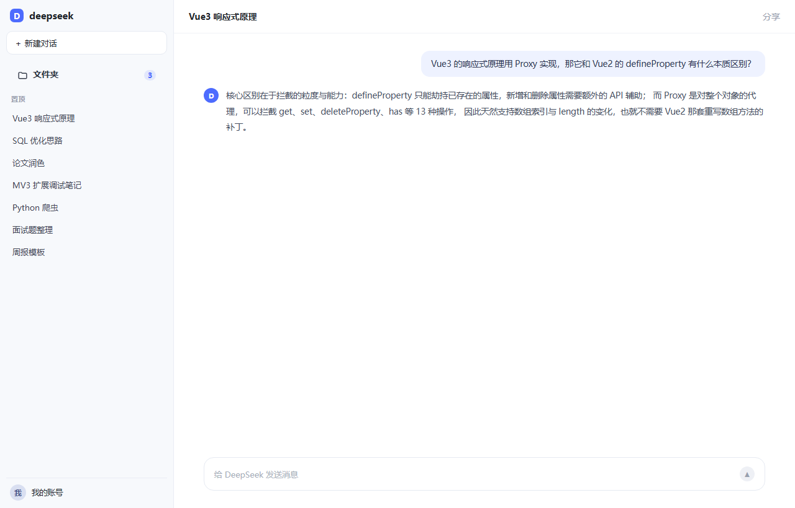
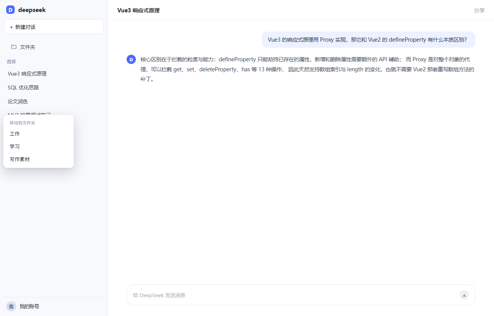
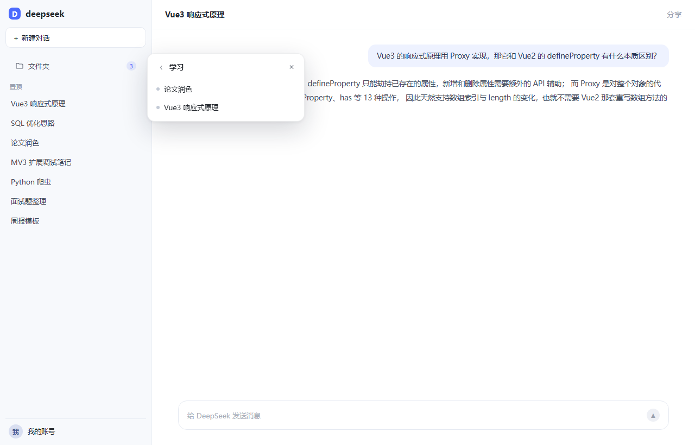
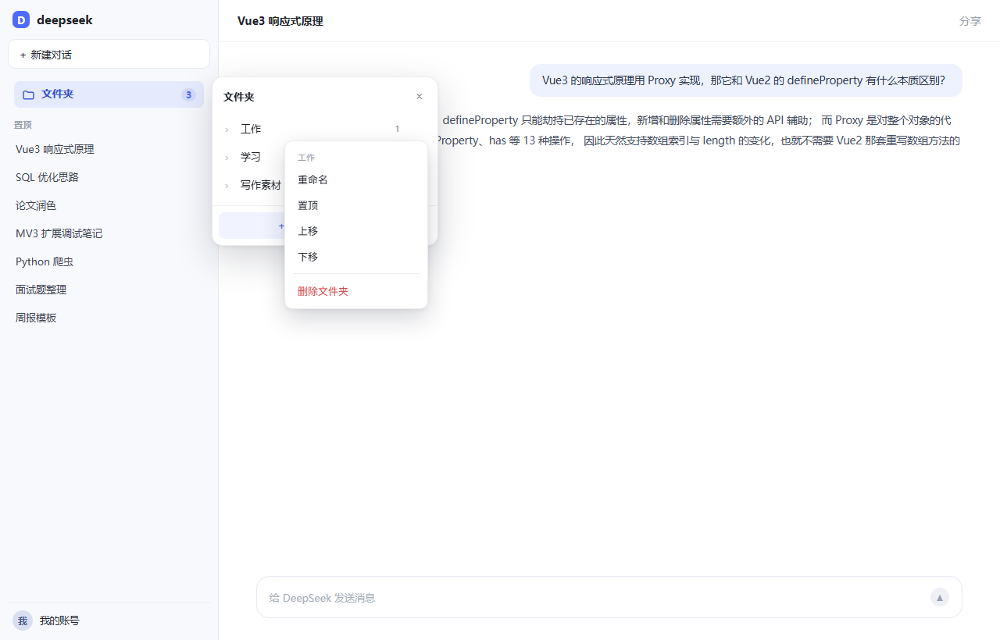
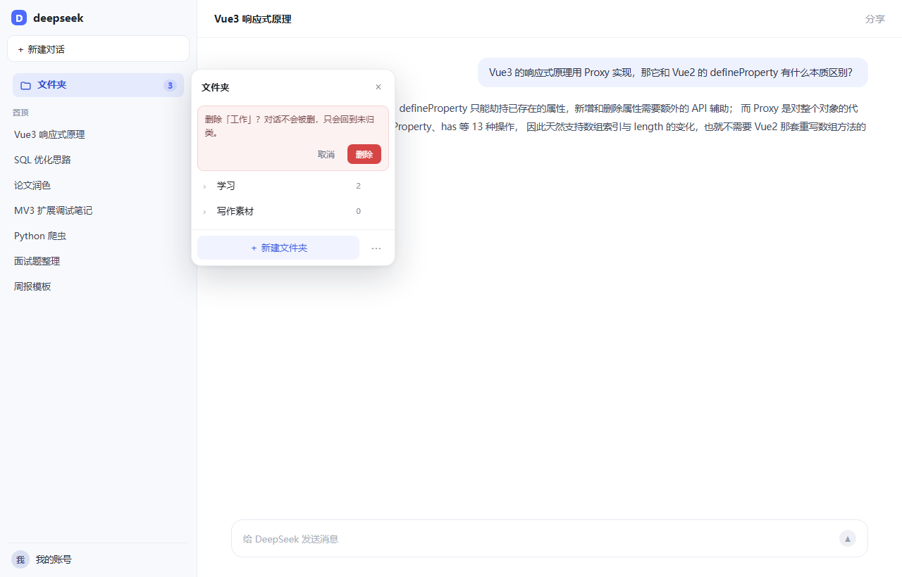
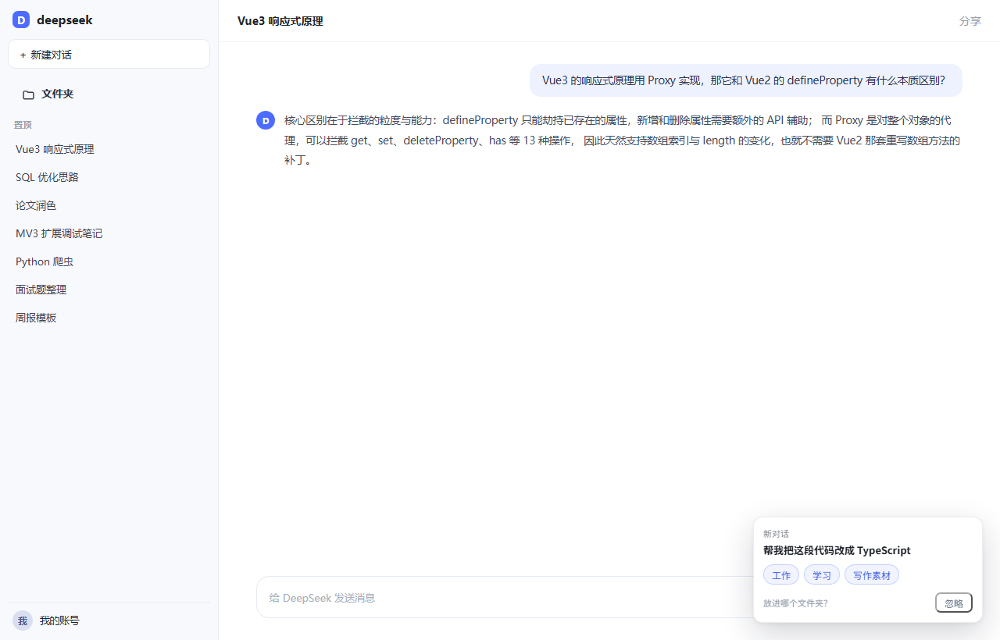
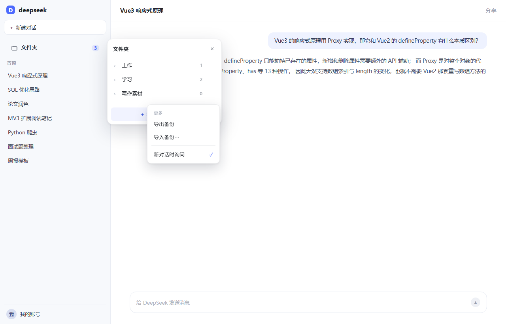

# DeepSeek 对话文件夹 · 使用说明

> 版本 **0.3.1** ｜ 适用浏览器：Chrome / Edge（桌面版）｜ 适用站点：chat.deepseek.com

---

## 一、它能做什么

在 DeepSeek 网页版的侧栏里加一层「文件夹」，把历史对话按项目、主题、课程分门别类。

- 文件夹数量不限，随时建、改名、置顶、排序、删除
- 把任意对话拖进去，一个对话只属于一个文件夹
- 点开文件夹只看这一类对话，点一下正常打开
- **不改变 DeepSeek 原生对话列表的结构和交互**
- 纯本地存储，不联网、不读对话正文、不碰账号



---

## 二、安装

1. 打开 `chrome://extensions`（Edge 是 `edge://extensions`）
2. 右上角打开「**开发者模式**」
3. 点左上角「**加载已解压的扩展程序**」
4. 选择本项目的 `extension` 目录：
   - ✅ 正确：`E:\DS chat manager\extension`（里面能直接看到 manifest.json、src、icons）
   - ❌ 错误：选到上一层的 `DS chat manager`，会提示 "Manifest file is missing"
5. 打开 <https://chat.deepseek.com>，**刷新页面**

装好后扩展列表里会有一张卡片：**DeepSeek 对话文件夹**。

---

## 三、界面导览

### 1. 侧栏入口

在「历史对话 / 置顶」列表的正上方，多了一行 **📁 文件夹**，右侧数字是文件夹总数。

- 点一下 → 打开面板
- 再点一下 / 点面板外 / 按 `Esc` → 关闭

### 2. 面板

分成三块：

| 位置 | 内容 |
| --- | --- |
| 顶部 | 标题（进入文件夹后显示文件夹名，左侧有返回箭头）、关闭 |
| 中间 | 文件夹列表，或某个文件夹里的对话 |
| 底部 | 「＋ 新建文件夹」和「⋯（更多）」 |

---

## 四、基本操作

### 新建文件夹

1. 点侧栏「文件夹」打开面板
2. 点底部「＋ 新建文件夹」
3. 输入名字 → **回车**（`Esc` 取消）
4. 名字重复会提示，最多 24 个字

### 把对话放进文件夹（两种方式）

**方式一：拖拽（推荐）**

1. 按住左侧某条对话不放
2. 拖到面板里的某个文件夹上，文件夹会高亮
3. 松手 → 提示「已放入「工作」」

> 面板没开也没关系：开始拖动的瞬间面板会自动弹出来。

**方式二：右键**

1. 在对话上点右键
2. 选「移动到文件夹」→ 点文件夹名
3. 已经归类的会打 ✓，下方还有「移出文件夹」



### 查看文件夹里的对话

点文件夹 → 进入文件夹视图，列表按**加入时间倒序**排列，点任意一条即正常打开该对话。



### 把对话移出文件夹

在文件夹视图里，鼠标移到条目上 → 右侧出现「**移出**」→ 点了就回到未归类。

> 移出只是解除归类，**对话本身不会被删除**。

---

## 五、管理文件夹

鼠标移到文件夹行，右侧出现 `⋯`，点开是完整菜单：



| 菜单项 | 说明 |
| --- | --- |
| **重命名** | 行内变输入框，改名后回车保存，`Esc` 取消 |
| **置顶 / 取消置顶** | 置顶的排在最前，左边小图标变成 ★ |
| **上移 / 下移** | 手动调整顺序（只影响未置顶的组内顺序） |
| **删除文件夹** | 行内二次确认，见下图 |



> 删除文件夹时，里面的对话**不会被删除**，只是回到「未归类」状态。

---

## 六、新对话提示

页面打开后，如果你新建了一个对话，右下角会弹出一张小卡片：



- 点任意文件夹名 → 直接放入
- 点「忽略」→ 关掉
- 20 秒不操作自动收起
- **只对页面打开之后新建的对话提示**，历史对话不会弹

关掉这个功能：面板底部 `⋯` →「新对话时询问」（勾选状态，点一下即切换）。

---

## 七、备份与迁移

面板底部 `⋯` 里有：



- **导出备份**：下载一个 `dscm-backup-日期.json`，含全部文件夹和归类
- **导入备份…**：选择 JSON 文件，**会覆盖当前数据**（有二次确认）

### 什么时候必须备份

> ⚠️ 在 `chrome://extensions` 里「**移除**」扩展，Chrome 会**连带清空它的全部存储**。
> 重装回来就是空的 —— 这不是 bug，是浏览器规则。

想保留数据：**用 ⟳ 重载，不要移除**；确实要重装，先导出。

换电脑、换浏览器、换配置：导出 → 在新环境导入。

---

## 八、开关与卸载

### 临时关闭

点浏览器工具栏上的扩展图标：

- 一下 = 隐藏侧栏入口（图标出现 `OFF` 角标）
- 再一下 = 恢复显示
- **数据完全不受影响**，随时切回来

### 彻底不用了

`chrome://extensions` → 移除。移除后页面恢复原样，没有任何残留；
但数据会一起清空，介意的话先导出备份。

---

## 九、数据与隐私

| 项目 | 说明 |
| --- | --- |
| 存了什么 | 文件夹名称、文件夹顺序/置顶、对话 id → 文件夹 的映射、对话标题快照 |
| 存在哪 | 浏览器本地 `chrome.storage.local` |
| 上传吗 | **不上传、不联网**，扩展没有任何网络请求 |
| 读正文吗 | **不读**。只读取列表里的标题文字和链接地址 |
| 账号凭证 | **不接触** |
| 权限 | 只需要 `storage` + `chat.deepseek.com` 的页面权限 |

---

## 十、常见问题

**Q：装好了，侧栏没出现「文件夹」？**

1. 确认刷新过页面（装完必须刷新）
2. 确认地址栏是 `chat.deepseek.com`
3. 按 F12 打开控制台，输入 `DSCM.inspect()` 回车，把结果发我

**Q：入口位置压住了别的按钮？**

0.3.1 会自动测量原生按钮位置并向下避让。如果仍然重叠，把截图发我。

**Q：改了对话的名字，文件夹里的没变 / 记录没了？**

0.3.1 已处理：改名会重建会话（id 变化），现在会把归类关系迁到新 id 上。
极端情况下在控制台跑 `DSCM.diag()` 可以看到最近的迁移/删除记录。

**Q：在 DeepSeek 里删了对话，文件夹里还留着？**

删除同步有 **6 秒**缓冲（防止把改名误判成删除），最多 9 秒左右生效，会弹提示。

**Q：深色模式正常吗？**

面板和入口会跟随页面的深浅色自动切换。

**Q：能同步到别的电脑吗？**

不能自动同步（本地存储）。用「导出 / 导入」手动搬。

**Q：会上架应用商店吗？**

暂时没有，走开发者模式加载。

---

## 十一、诊断命令（出问题时用）

在 DeepSeek 页面的控制台（F12）执行：

```js
DSCM.inspect()   // 入口是否注入、找到几条对话、列表容器是谁
DSCM.diag()      // 最近 40 条「迁移 / 删除」事件
```

把输出发给我，基本能直接定位问题。

---

## 十二、快捷键

| 按键 | 作用 |
| --- | --- |
| `Esc` | 关闭面板 / 关闭菜单 / 取消新建或改名 |
| `Enter` | 确认新建、改名 |
| 右键对话 | 打开「移动到文件夹」菜单 |
| `Ctrl/Cmd + 点击` | 行为同原生（新标签打开） |

---

*文档随版本更新；当前对应 v0.3.1。*
